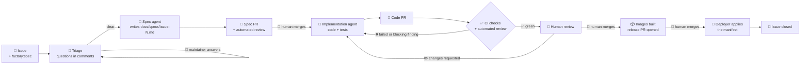
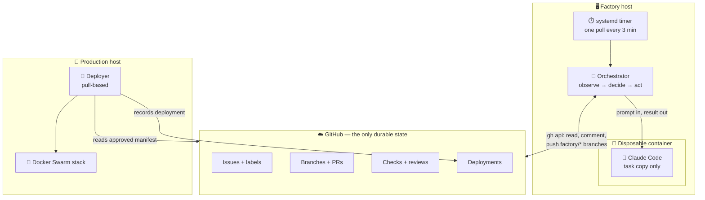
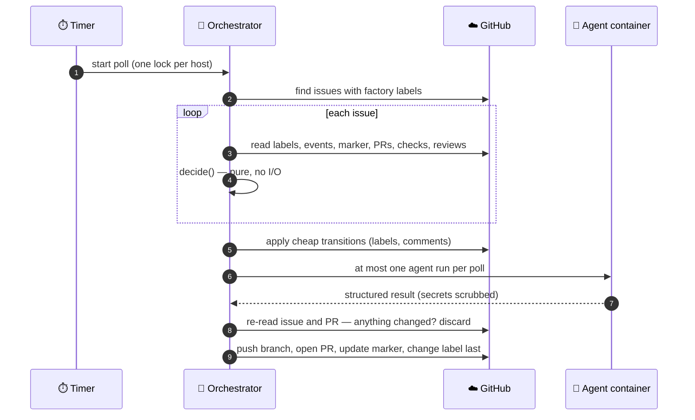
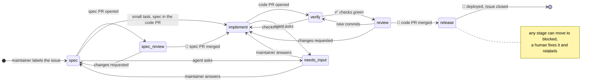
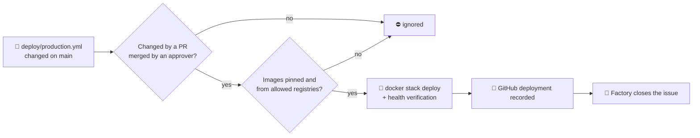

<div align="center">

# 🏭 Dev Factory

### Label an issue. Get a spec, the code, a reviewed PR and a deployed release, with a human approving every step that matters.

**A GitHub-native orchestrator that lets Claude Code build features while a deterministic
Python state machine decides what happens next.**

[](https://github.com/abegalinov/dev-factory/actions/workflows/ci.yml)


[](LICENSE)

[How it works](#-how-it-works) · [Lifecycle](#-the-lifecycle) · [Safety](#-safety-first) ·
[Quick start](#-quick-start) · [Deployer](#-the-deployer) · [Docs](#-documentation)

</div>

---

## ✨ Why Dev Factory?

Most AI coding setups are either a chat window or a bot that pushes code and hopes. Dev Factory
sits between the two: **the AI does the creative work, a boring and predictable program does
the bookkeeping, and humans keep the keys.**

| | |
|---|---|
| 🗂️ **GitHub is the only state** | Issues, labels, branches, PRs, checks, comments and deployments. No database, no queue. Delete the server's disk and nothing is lost |
| 🧠 **Claude creates, the orchestrator decides** | Claude writes specs and code in a sandbox. It never touches labels, never merges, never deploys |
| 🙋 **Three human gates, not configurable** | A human merges the spec, merges the code and approves the release. Always |
| 💥 **Safe to crash, safe to re-run** | Every poll rebuilds its view from GitHub, reuses what exists and changes the label last. Killed mid-step, it picks up without repeating side effects |
| 🔒 **Sandboxed agents** | Each run gets a throwaway container: no capabilities, read-only root, no `.git`, no GitHub token, resource caps |
| 💬 **Triage before the spec** | Optional: the agent first challenges the issue in its comments (scope, assumptions, problems in the code, questions with suggested answers) and writes the spec once it is clear |
| 🎬 **Demo videos** | Optional: CI records the feature's scenario on the emulator, and the factory posts the video on the PR and the issue |
| 🔁 **Feedback loops built in** | CI failures, automated review findings and human change requests go back to the agent as its next task |
| 🧩 **Project-agnostic** | A repository describes itself in `.dev-factory/`: components, checks, protected paths, release. The factory stays generic |

## 🔭 How it works

You add one label. Everything after that is visible on GitHub, as PRs and comments you can read
and review.



Under the hood there are three parts:



Every poll is the same loop, and **the decision step is a pure function**: GitHub snapshot in,
exactly one action out. That makes it easy to test, and easy to reason about.



## 🏷️ The lifecycle

The stage lives in a label. A factory-owned marker comment on the issue keeps the counters and
pointers. Both are on GitHub.



| Label | Who acts | What happens |
|---|---|---|
| `factory:spec` | 🤖 agent | Triages the issue in its comments (optional), then drafts the spec as a PR. An automated reviewer checks the first draft. A small task skips the spec PR (`agent.fast_track`): its code PR carries the spec |
| `factory:spec-review` | 🙋 human | Merge the spec PR to approve it, or request changes |
| `factory:implement` | 🤖 agent | Implements the approved spec with tests, opens the code PR |
| `factory:verify` | ✅ CI | The repository's own checks run. Failures go back to the agent with the log excerpt |
| `factory:review` | 🙋 human | Review and merge the code PR. Change requests go back to the agent |
| `factory:release` | 🙋 human | The candidate is announced. A human approves the deployment, then the issue closes |
| `factory:needs-input` | 🙋 human | The agent asked a question. A maintainer's reply resumes the work |
| `factory:blocked` | 🙋 human | Something needs a person. Fix it and relabel to resume |

Only labels and comments from users with **Write access** count. Everyone else is ignored.

## 🛡️ Safety first

Dev Factory assumes that issue text can be hostile and that agents can be tricked. Each threat
has a control in code:

| 🎯 Threat | 🧱 Control |
|---|---|
| A stranger triggers an agent | Only the latest lifecycle label from a user with Write access counts |
| Prompt injection | Only maintainers' text reaches the agent, fenced as untrusted data |
| The factory approves itself | It has no merge calls at all, and a PR merged by the factory account blocks the issue |
| Agent steals the GitHub token | It never gets it. The container sees only the task copy and its Claude token |
| Agent leaks its Claude token | The token is scrubbed from every result before it reaches GitHub. A file containing it blocks the push |
| Agent plants git hooks | It edits a copy without `.git`. Orchestrator git runs with hooks off and never force-pushes |
| Agent edits CI or deployment | Protected paths (`.github/**`, `.dev-factory/**` plus your own) block the issue |
| Repo-shipped Claude settings | Ignored: user settings only, strict MCP config, explicit tool allowlist |
| A human acts during a long run | Issue and PR are re-read after the run. If anything changed, the work is discarded |
| Overlapping runs | One lock per account, whatever config is used, plus a timer that never overlaps |
| Runaway cost | Bounded attempts, max turns, max budget per run, one agent run per poll |
| Exhausting a small host | Memory, CPU and pid caps, swap off, OOM priority, a systemd slice, deferral while busy |

It also ships in **observe-only mode**: no GitHub writes and no agent runs until you turn that
off on purpose.

## 💥 Crash-safe by design

The process may die between any two API calls. Each case is covered by an integration test
with crash injection against an in-memory GitHub.

| 💀 Killed... | 🔄 Next poll |
|---|---|
| after pushing, before opening the PR | Sees the branch ahead of `main` with no PR, opens it. The agent does not run again |
| after opening the PR, before saving state | Finds the PR by its branch name, carries on, no duplicate comment |
| after saving state, before changing the label | Detects the interrupted transition and completes it |
| while holding the lock | The kernel releases the `flock`; the next run starts normally |

The rule behind all of it: **read before acting, reuse what exists, change the label last.**

## 🚀 Quick start

```bash
git clone https://github.com/abegalinov/dev-factory && cd dev-factory
python3 -m venv .venv && .venv/bin/pip install -e ".[dev]"     # or use uv
.venv/bin/pytest -q                                             # 204 tests, under a second

.venv/bin/dev-factory validate                                  # offline config check
.venv/bin/dev-factory doctor --project <id>                     # tools, identity, access, labels
.venv/bin/dev-factory labels bootstrap --project <id> --apply   # create the factory labels
.venv/bin/dev-factory poll                                      # one pass, observe-only by default
```

On a server, one script installs the systemd timer (observe-only until you pass `--mutate`):

```bash
sudo sh deploy/host/install-factory.sh --project config/projects/<id>.yaml \
  --gh-user <factory-account> --agent-env ~/.config/dev-factory/agent.env
```

[docs/operations.md](docs/operations.md) walks through it: the agent image, an observe-only
trial, then mutation mode.

### Commands

| Command | Effect |
|---|---|
| `validate` | Parse and validate all config, offline |
| `doctor [--project ID]` | Read-only checks: `git`/`gh`/`claude`, identity, write permission, branch protection, labels, isolation |
| `labels bootstrap [--project ID] [--apply]` | Create missing factory labels. Never modifies existing ones |
| `poll` | One discovery/decision pass. In observe-only mode it only prints decisions |
| `config check PATH` | Validate a repository's `.dev-factory/` directory |
| `deployer install\|run\|status\|retry` | The production deployer (see below) |

All commands accept `--config-dir` (default: `$DEV_FACTORY_CONFIG`, else `./config`).

## ⚙️ Configuration

```text
config/factory.yaml              🖥️ host: runtime, GitHub, Claude, container limits, policy
config/projects/<id>.yaml        📌 registers a repository: name, enabled, agent image
<your repo>/.dev-factory/        📁 the project describes itself, read from its default branch
├── config.yaml                     spec directory, components, checks, protected paths, release
├── instructions.md                 guidance for every agent prompt
└── templates/
    ├── spec.md                     structure of every spec
    ├── review.md                   what the automated reviewer looks for
    └── pr-body.md                  template for code PR descriptions
```

- Human approval of spec, code and deployment is **not** configurable.
- Never put tokens in YAML. `gh` and `claude` keep their own credentials.
- See [docs/repo-config.md](docs/repo-config.md) and the full example in
  [examples/dev-factory/](examples/dev-factory/).

## 📡 The deployer

An optional, separate pull agent for the production host. It never runs where agents run, and
it holds its own tokens, separate from the factory's.



Install with one command (`deployer install`). It also repairs drift and never retries a failed
manifest on its own. See [docs/deployer.md](docs/deployer.md).

## 📚 Documentation

| Document | Contents |
|---|---|
| 🏛️ [docs/architecture.md](docs/architecture.md) | **Start here.** The parts, the poll loop, a feature end to end, state, safety model |
| 📜 [docs/issue-contract.md](docs/issue-contract.md) | The exact rules: labels, authorization, marker, each stage's evidence and exits, recovery |
| 🛠️ [docs/operations.md](docs/operations.md) | Install, onboard a repository, observe-only trial, isolation, systemd, day-to-day |
| 📁 [docs/repo-config.md](docs/repo-config.md) | Everything a repository can set in `.dev-factory/` |
| 📡 [docs/deployer.md](docs/deployer.md) | The production deployer: install, approval rules, operations |

## 📈 Status

- ✅ **Implemented and tested:** 204 tests, including full-lifecycle integration tests with
  crash injection.
- ✅ **Proven on a real monorepo:** a feature taken from issue to release through every human
  gate, with CI failures, review findings and change requests fed back to the agents.
- 🧪 **Shipped observe-only:** the default config never writes until you decide it should.

## 🧑‍💻 Development

```bash
.venv/bin/ruff check .
.venv/bin/pytest -q
```

CI runs both on every push and pull request.

## 📄 License

[MIT](LICENSE). Use it, fork it, build on it.

<div align="center">

---

**If Dev Factory gives you ideas, a ⭐ helps other people find it.**

Issues and discussions are welcome.

</div>
